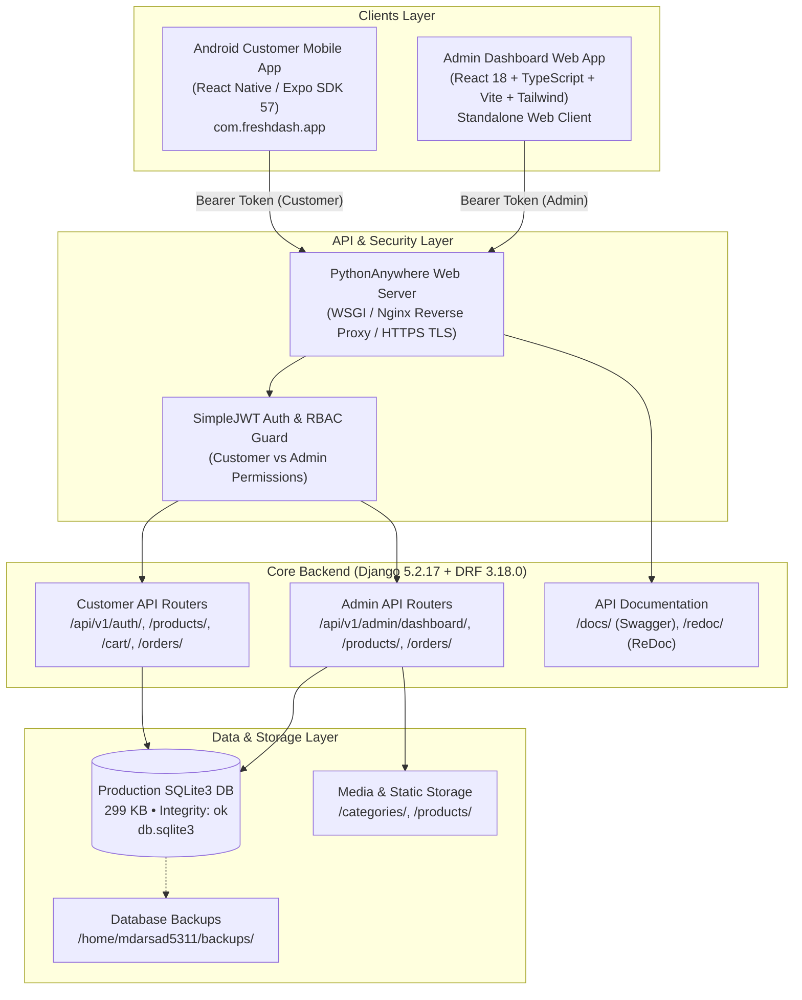

# FreshDash – Complete Project & Feature Report

**Project Name:** FreshDash (E-Commerce Fresh Produce Platform)  
**Date of Audit & Report:** November 5, 2026  
**Repositories:**
- **Backend:** `https://github.com/mdarsad-5311/freshdash-backend` (Branch: `master`)
- **Frontend & Admin:** `https://github.com/mdarsad-5311/freshdash` (Branch: `master`)
**Production Host:** PythonAnywhere (`mdarsad5311.pythonanywhere.com`)  
**Live Production API:** `https://mdarsad5311.pythonanywhere.com/api/v1`  
**Android Mobile App:** Package `com.freshdash.app` (EAS Build `8e0a9b6d`, Expo SDK 57)  
**APK Download Link:** [Download FreshDash Android Preview APK](https://expo.dev/artifacts/eas/vYZ4vjFFdzwiGwtNzc6e5zAGEi_XsrfbBdnB07S81rg.apk)  

---

## 1. Executive Summary & Ecosystem Architecture

FreshDash is a full-stack, enterprise-grade e-commerce platform purpose-built for fast, fresh produce delivery (fruits, vegetables, leafy greens, roots, and organic groceries). The system comprises three independent, loosely-coupled components designed to work together seamlessly:

---

## 2. Technology Stack Breakdown

| Tier | Technologies & Packages | Versions | Purpose / Role |
|---|---|---|---|
| **Backend Framework** | Django, Django REST Framework | `5.2.17`, `3.18.0` | Core API engine, ORM, routers, permissions |
| **Authentication** | `djangorestframework-simplejwt` | `5.5.1` | Access and Refresh token lifecycle, rotation & blacklisting |
| **Database** | SQLite3 (Pure, Zero Data Loss) | `3.45+` | Relational storage for users, catalog, cart, orders, addresses |
| **API Docs & Schema** | `drf-spectacular` | `0.30.0` | OpenAPI 3.0 schema generation, Swagger UI & ReDoc |
| **Image Processing** | `Pillow` | `12.3.0` | Upload processing for product & category media assets |
| **CORS Management** | `django-cors-headers` | `4.9.0` | Secure cross-origin access for web admin & development clients |
| **Production Hosting** | PythonAnywhere | Python `3.12` | Production WSGI web app hosting (`mdarsad5311.pythonanywhere.com`) |
| **Mobile Framework** | React Native, Expo | `0.86.3`, `57.0.31` | Cross-platform mobile customer application |
| **Mobile Routing** | Expo Router | `~57.0.29` | File-based, typed routing for customer mobile screens |
| **Mobile Storage** | `expo-secure-store` | `~57.0.4` | Hardware-backed encrypted JWT token & user data storage |
| **State Management** | Zustand (`useShop`), React Context | `^5.0.15` | Reactive shopping cart state, totals, and auth session |
| **Mobile UI & Styling** | Lucide React Native, Google Fonts Inter | `1.58.0`, `0.4.2` | Clean, high-performance UI typography & vector icons |
| **Cloud Build (EAS)** | EAS CLI, EAS Cloud Builder | `27.4.1` | Automated Android Preview APK compiling and signing |
| **Admin Web Frontend** | React, TypeScript, Vite, Tailwind CSS | `18.3.1`, `5.7.2`, `6.1.0` | High-productivity administrative dashboard web application |
| **Admin Charts** | Recharts | `2.15.1` | Analytics, revenue, and order distribution data visualization |

---

## 3. Backend Features & Domain Models

### 3.1 Database Schema & Data Models
The backend is structured around 10 relational models in [`api/models.py`](file:///c:/Users/SIS/OneDrive/Desktop/freshdash-backend/api/models.py):

1. **`Category` (`api_category`):**
   - **Fields:** `id` (Slug PK, e.g. `'vegetables'`), `name`, `photo` (atlas index), `tint` (hex background color for mobile cards), `image` (uploaded media), `is_active`, `created_at`, `updated_at`.
   - **Production Records:** 9 categories (Vegetables, Fruits, Leafy greens, Roots, Exotic, Citrus, Berries, Organic, Daily essentials).

2. **`Product` (`api_product`):**
   - **Fields:** `id` (Slug PK, e.g. `'mango'`, `'tomato'`), `name`, `weight` (pack descriptor e.g. `'500 g'`, `'1 kg'`), `price`, `original` (strikethrough MRP), `category_id`, `popular` (bestseller flag), `organic` (organic badge), `description`, `stock` (inventory count, default 50), `image` (uploaded media), `is_available`, timestamps.
   - **Properties:**
     - `discount_percentage`: Dynamically computed `100 * (1 - price / original)`.
     - `is_low_stock`: Flags products where `0 < stock <= 10`.
     - `is_out_of_stock`: True if `stock == 0` or `not is_available`.
   - **Production Records:** 13 produce items.

3. **`UserProfile` (`api_userprofile`):**
   - **Fields:** `user_id` (OneToOne PK), `role` (`'admin'`, `'manager'`, `'customer'`), `phone_number`, `order_updates` (push toggle), `offers_notifications` (marketing toggle), timestamps.
   - **Signals:** Auto-created via `post_save` on `User`. Automatically grants `'admin'` role if `is_staff` or `is_superuser` is set.

4. **`Address` (`api_address`):**
   - **Fields:** `id`, `user_id`, `name` (`'Home'`, `'Work'`, `'Other'`), `line`, `area`, `is_default`, timestamps.
   - **Behavior:** Setting `is_default=True` automatically unsets default flag on user's other addresses.

5. **`CartItem` (`api_cartitem`):**
   - **Fields:** `id`, `user_id`, `product_id`, `quantity`, `large` (boolean toggle for double pack size variant), timestamps.
   - **Constraints:** `UniqueConstraint(fields=['user', 'product', 'large'])`.
   - **Properties:** Dynamic `unit_price`, `unit_original`, `total_price`, and `total_savings`.

6. **`Coupon` (`api_coupon`):**
   - **Fields:** `code` (PK e.g. `'FRESH20'`), `description`, `discount_rate` (e.g. `0.20`), `max_discount` (e.g. ₹50.00), `min_order_value`, `is_active`.
   - **Methods:** `calculate_discount(item_total)` enforces order value thresholds and discount caps.

7. **`Order` (`api_order`):**
   - **Fields:** `id`, `order_number` (unique string, e.g. `'FD-2026-XXXX'`), `user_id`, `status` (`pending`, `placed`, `confirmed`, `processing`, `shipped`, `out_for_delivery`, `delivered`, `cancelled`), `payment_method` (`COD`, `UPI`, `Card`, `NetBanking`, `Wallet`), `payment_status` (`pending`, `paid`, `failed`, `refunded`), `delivery_address_id`, `delivery_address_snapshot` (immutable JSON snapshot of delivery location at time of order), `item_total`, `delivery_fee`, `discount_amount`, `grand_total`, `coupon_code`, timestamps.

8. **`OrderItem` (`api_orderitem`):**
   - **Fields:** `order_id`, `product_id`, `product_name`, `weight`, `quantity`, `large`, `unit_price`, `total_price`.

9. **`FavoriteProduct` (`api_favoriteproduct`):**
   - **Fields:** `user_id`, `product_id`, `created_at`.
   - **Constraint:** Unique bookmark per user and product.

10. **`FAQ` (`api_faq`):**
    - **Fields:** `question`, `answer`, `order`, `is_active`.

---

## 4. Complete API Endpoint Catalog

All endpoints are hosted under base URL `https://mdarsad5311.pythonanywhere.com/api/v1/`.

### 4.1 System & Documentation
- `GET /health/` — System health, service name, and version check (200 OK).
- `GET /docs/` — Interactive Swagger UI.
- `GET /redoc/` — ReDoc technical API documentation.
- `GET /schema/` — OpenAPI 3.0 YAML/JSON specification.

### 4.2 Customer Authentication & Profile
- `POST /auth/login/` — Customer login with username/email and password. Returns JWT access & refresh tokens and user object.
- `POST /auth/signup/` — Customer registration with username, email, phone, and password.
- `POST /auth/token/refresh/` — Rotates and generates fresh access token from refresh token.
- `POST /auth/logout/` — Blacklists refresh token in database.
- `GET /auth/me/` — Retrieves authenticated customer's profile, phone, and notification settings.
- `PATCH /auth/me/` — Updates customer profile metadata.

### 4.3 Customer Storefront & Catalog
- `GET /products/` — Filterable product catalog (supports search by name, category filter, organic/popular filters).
- `GET /products/<id_or_slug>/` — Detailed product view with stock availability and discount computations.
- `GET /categories/` — List all active categories with product counts.
- `GET /categories/<id>/` — View single category and its produce listings.

### 4.4 Shopping Cart & Checkout
- `GET /cart/` — Retrieves authenticated user's basket with itemized subtotals, savings, and delivery fee.
- `POST /cart/items/` — Adds item or pack variant to cart.
- `PATCH /cart/items/<id>/` — Modifies cart item quantity.
- `DELETE /cart/items/<id>/` — Removes specific line item from cart.
- `POST /cart/clear/` — Empties current user cart.

### 4.5 Customer Addresses & Orders
- `GET /addresses/` — List saved customer delivery locations.
- `POST /addresses/` — Add new address (with automatic default address handling).
- `PATCH /addresses/<id>/` — Update address line or mark as default.
- `DELETE /addresses/<id>/` — Delete address.
- `GET /orders/` — Retrieve user's order history.
- `POST /orders/` — Place order from current cart (validates stock, applies coupons, captures address snapshot).
- `GET /orders/<order_number>/` — Order tracking details and status timeline.

### 4.6 Promotions, Bookmarks & Support
- `GET /coupons/` — List active coupon promotions.
- `POST /coupons/validate/` — Validates coupon against an order subtotal.
- `GET /favorites/` & `POST /favorites/` — Bookmark management.
- `GET /faqs/` — Help center questions and answers.

### 4.7 Dedicated Admin Management APIs (`/api/v1/admin/`)
*Protected by `IsAdminUser` / Staff RBAC guards. Regular customers receive HTTP 403 Forbidden.*

- `POST /admin/auth/login/` — Admin-only login (verifies staff/superuser status).
- `GET /admin/auth/me/` — Verified administrative session details.
- `POST /admin/auth/logout/` — Invalidation of admin JWT refresh token.
- `GET /admin/dashboard/` — Real-time business intelligence metrics:
  - `total_revenue`, `total_orders`, `total_products`, `total_customers`, `low_stock_count`, `out_of_stock_count`.
  - Category product distribution summary.
- `GET /admin/products/` & `POST /admin/products/` — Full catalog CRUD with image upload and stock control.
- `PATCH /admin/products/<id>/` & `DELETE /admin/products/<id>/` — Modify product or deactivate.
- `GET /admin/categories/` & `POST /admin/categories/` — Category management with icon/color configuration.
- `PATCH /admin/categories/<id>/` & `DELETE /admin/categories/<id>/` — Category update or safe deletion.
- `GET /admin/orders/` & `GET /admin/orders/<id>/` — Order operations across all customers.
- `PATCH /admin/orders/<id>/status/` — Update order delivery lifecycle (`placed` -> `processing` -> `shipped` -> `delivered`).
- `GET /admin/customers/` & `GET /admin/customers/<id>/` — Customer directory with order count & lifetime spend.
- `GET /admin/inventory/` — Dedicated stock management table with low-stock warnings.
- `PATCH /admin/inventory/<id>/stock/` — Quick inline stock count adjustments.

---

## 5. Customer Mobile Application Features (React Native + Expo)

The customer application is built cleanly inside [`freshdash/app/`](file:///c:/Users/SIS/OneDrive/Desktop/freshdash/app) using Expo Router:

### 5.1 Screens & User Journey
1. **App Startup & Splash:**
   - Preloads Google Inter font variants (`400Regular`, `500Medium`, `600SemiBold`, `700Bold`).
   - Automatically hides splash screen after assets and authentication state are hydrated.
2. **Home Tab (`app/(tabs)/index.tsx`):**
   - Header with greeting, delivery address selector pill, and search shortcut.
   - Promotional banner carousel for seasonal offers and discounts.
   - Category horizontal pill selector with tinted backgrounds.
   - "Everyday Produce" bestsellers grid with one-tap add-to-cart buttons.
   - "Certified Organic" produce section highlighting chemical-free items.
3. **Categories Tab (`app/(tabs)/categories.tsx`):**
   - Visual grid of produce categories with product count badges.
   - Direct drill-down to category listing screens.
4. **Product Details Screen (`app/product/[id].tsx`):**
   - High-resolution hero image with category tint badge.
   - Weight pack descriptor, pricing, savings percentage badge.
   - Pack size selector (Regular Pack vs Double Pack).
   - Real-time stock status indicator.
   - Item description and nutritional highlights.
   - Floating "Add to Basket" / Quantity Stepper bar.
5. **Cart Tab (`app/(tabs)/cart.tsx`):**
   - List of active items with pack size indicator and inline increment/decrement controls.
   - Empty state illustration with "Start Shopping" call to action.
   - Coupon promo code input with instant discount calculation.
   - Bill breakdown: Item subtotal, discount savings, delivery fee, and grand total.
   - Delivery address selector pill.
   - Slide-to-confirm / Checkout action button.
6. **Order Confirmation & Tracking (`app/order/[orderNumber].tsx`):**
   - Visual progress timeline: Placed -> Confirmed -> Out for Delivery -> Delivered.
   - Delivery location snapshot, payment method badge, and full itemized receipt.
7. **Profile Tab (`app/(tabs)/profile.tsx`):**
   - User profile header with username, email, and phone.
   - Shortcuts to "My Orders", "Saved Addresses", and "Help & Support".
   - Notification preference switches (Order updates, Special offers).
   - Secure Logout action with confirmation dialog.
8. **Auth Stack (`app/(auth)/login.tsx` & `signup.tsx`):**
   - Clean, modern form layouts with input validation (email/username, password, phone).
   - Secure credential storage in `expo-secure-store`.
   - Seamless toggle between Sign In and Sign Up.

### 5.2 Mobile Client Infrastructure
- **Network Resilience:** Centralized Axios instance with 15-second timeout, error normalization, and offline/network failure messaging.
- **Silent JWT Refresh Mutex:** When an access token expires (HTTP 401), the client automatically pauses pending requests, calls `/auth/token/refresh/`, updates `expo-secure-store`, and replays failed requests without logging the customer out.
- **Cart State Synchronization:** Powered by Zustand store (`useShop`) with optimistic UI updates and local persistence.

---

## 6. Admin Dashboard Web Application Features

The Admin Management System is a separate web application located in [`freshdash/admin-dashboard/`](file:///c:/Users/SIS/OneDrive/Desktop/freshdash/admin-dashboard):

### 6.1 Architecture & Pages
- **`LoginPage.tsx`:** Dedicated administrative portal with shield icon, form validation, and error alert handling.
- **`DashboardPage.tsx`:**
  - KPI Stat Cards: Gross Revenue, Total Orders, Active Products, Registered Customers.
  - Quick alert widgets for Low-Stock items and Pending Orders requiring fulfillment.
  - Interactive charts (Category product distribution, recent revenue trends).
- **`ProductsPage.tsx`:**
  - Full catalog data table with search, category filtering, and status badges.
  - "Add Product" and "Edit Product" modals with image upload and live price/discount calculations.
  - One-click activate/deactivate toggle.
- **`CategoriesPage.tsx`:**
  - Category cards showing color tints, photo indexes, and active product counts.
  - Create and edit modals for category taxonomy.
  - Safe delete confirmation guard (blocks deletion if active products are assigned).
- **`OrdersPage.tsx`:**
  - Tabbed order management (`All`, `Placed`, `Processing`, `Shipped`, `Delivered`, `Cancelled`).
  - Search by order number or customer name.
  - Order detail inspection drawer with delivery address snapshot and itemized bill.
  - Status progression dropdown allowing admins to advance orders through fulfillment stages.
- **`CustomersPage.tsx` & `CustomerDetailPage.tsx`:**
  - Customer directory with user ID, username, email, phone, and role badge (`admin` / `customer`).
  - Drill-down view showing customer's lifetime orders, total spend, and registration date.
- **`InventoryPage.tsx`:**
  - Stock control interface with filter pills (`All Items`, `Low Stock (<= 10)`, `Out of Stock (0)`).
  - Quick inline stock adjustments (+/- buttons and direct input) updating the backend immediately.

---

## 7. Security, Roles & Access Control (RBAC)

1. **Role-Based Separation:**
   - **`customer`:** Can only access `/api/v1/` customer endpoints (catalog, cart, their own addresses and orders). Blocked from all `/api/v1/admin/` endpoints with HTTP 403 Forbidden.
   - **`admin`:** Full access to all administrative endpoints, customer endpoints, and Django administration.
   - **`manager`:** Operational role prepared for store managers and order fulfillment staff.
2. **Token Security:**
   - Uses cryptographic HMAC-SHA256 JWT tokens.
   - Short-lived Access Tokens (5 minutes to 1 hour).
   - Long-lived Refresh Tokens (7 to 30 days) with token rotation on each refresh.
   - Refresh token blacklisting on logout prevents reuse.
3. **Database Integrity & Zero-Loss Strategy:**
   - Automated timestamped backups created prior to schema migrations (`backups/`).
   - Pure SQLite3 engine (no risk of mismatched database drivers).
   - Live production integrity verified via `PRAGMA integrity_check;` (returned `ok`).

---

## 8. Current Build & Quality Verification Matrix

| Item | Verification Metric | Actual Result | Status |
|---|---|---|---|
| **Backend Migrations** | `0001_initial`, `0002_category_image_order_payment_method_and_more` | Applied in production (Nov 4) | **PASSED** |
| **Backend Database** | SQLite database path `/home/mdarsad5311/freshdash-backend/db.sqlite3` | 13 Users, 9 Categories, 13 Products, 2 Orders preserved | **PASSED** |
| **Backend Unit Tests** | `python manage.py test api` | 21 test cases passed | **PASSED** |
| **Live API Integration** | 22 endpoints tested against `mdarsad5311.pythonanywhere.com/api/v1` | All 22 requests succeeded (HTTP 200/400/403 as expected) | **PASSED** |
| **Mobile Test Suite** | `jest --watchAll=false` in `freshdash/` | 12 test suites passed (77 tests passed) | **PASSED** |
| **Mobile Health Check** | `npx expo-doctor` in `freshdash/` | 21/21 checks passed (0 errors) | **PASSED** |
| **Mobile Lint Check** | `npx expo lint` in `freshdash/` | Clean (0 lint errors) | **PASSED** |
| **Mobile Android Build** | EAS Build `8e0a9b6d-e2db-4998-a8a0-875a1d54438a` | Standalone Preview APK finished in 13 min | **FINISHED** |
| **Admin Web Build** | `tsc -b && vite build` in `freshdash/admin-dashboard/` | Compiled cleanly in 22.7s | **PASSED** |
| **Admin Code Isolation** | Verification that Admin code is absent from mobile APK router | 0 admin references in `app/` routes | **VERIFIED** |

---

## 9. Direct Download & Access Links

- **FreshDash Android Preview APK (Latest Build 8e0a9b6d):**  
  [Download APK (vYZ4vjFFdzwiGwtNzc6e5zAGEi_XsrfbBdnB07S81rg.apk)](https://expo.dev/artifacts/eas/vYZ4vjFFdzwiGwtNzc6e5zAGEi_XsrfbBdnB07S81rg.apk)
- **Expo Build Logs:**  
  [View Build 8e0a9b6d on Expo Dashboard](https://expo.dev/accounts/mdarsad/projects/freshdash/builds/8e0a9b6d-e2db-4998-a8a0-875a1d54438a)
- **Live Production Backend:**  
  `https://mdarsad5311.pythonanywhere.com/api/v1/`
- **Interactive Swagger Documentation:**  
  `https://mdarsad5311.pythonanywhere.com/api/v1/docs/`
- **Default Customer Demo Account:**  
  Username: `fresh_foodie` / Password: `FreshFoodie123!`
- **Default Admin Demo Account:**  
  Username: `admin_test` / Password: `pass123`

---

## 10. Remaining Roadmap & Next Steps

1. **Physical Handset Smoke Testing:**
   - Install the preview APK on a physical Android device to verify push notifications, touch responsiveness, and camera/photo permissions.
2. **Admin Dashboard Deployment:**
   - Deploy the production build of `admin-dashboard/` (e.g. to Vercel, Netlify, or as static files served via PythonAnywhere) so store administrators can manage catalog and orders from any desktop web browser.
3. **Payment Gateway Integration:**
   - Currently, payments support Cash on Delivery (COD) and mocked UPI/Card. Live Razorpay or Stripe webhooks can be activated when merchant credentials are provided.
